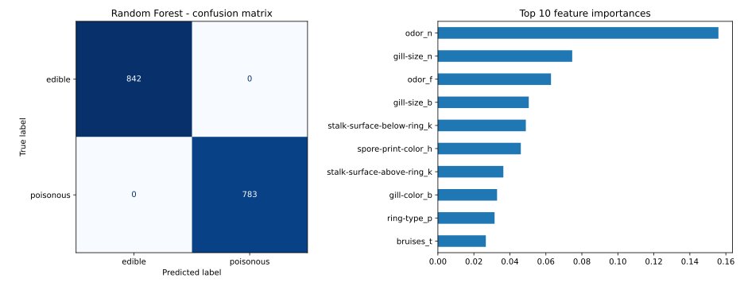

# Mushroom Edibility Classification

Practice project built with AI assistance on a public dataset. It classifies
mushrooms as edible or poisonous from 22 categorical features (cap shape,
odor, gill size, ...). It has two parts:

- `mushroom_classification.py` - trains a decision tree and a random
  forest, compares them, and plots a confusion matrix and feature
  importances.
- `app.py` - a Streamlit web app that trains the random forest, shows its
  evaluation, and lets you describe a mushroom in the sidebar to get a
  prediction.

## Dataset

The UCI Mushroom dataset: 8124 mushroom records, each described by 22
categorical attributes, labeled edible or poisonous (4208 edible / 3916
poisonous). Source: UCI Machine Learning Repository. The CSV is not stored
in this repo (it is ~800 KB); the script downloads it from UCI on the first
run and adds the official column names.

## How to run

```bash
pip install -r requirements.txt
python mushroom_classification.py   # model comparison + plots
streamlit run app.py                # web app on http://localhost:8501
```

The script downloads the data if needed, one-hot encodes the categorical features (117 binary columns),
trains both models, prints test accuracy, and saves a confusion matrix and
feature-importance plot to `results.svg`.

## Results (test split = 20%, random_state=42)

| Model         | Test accuracy | 5-fold cross-validation |
|---------------|---------------|-------------------------|
| Decision Tree | 0.9988        | 0.9995 (+/- 0.0005)     |
| Random Forest | 1.0000        | 1.0000 (+/- 0.0000)     |

(Cross-validation uses shuffled stratified folds; the dataset is ordered
by class, so unshuffled folds give misleading scores.)

The most important feature by far is odor, which matches what is known
about this dataset.



## Honest notes

- Learning exercise. This dataset is famous for being almost perfectly
  separable (odor alone separates most cases), so near-perfect accuracy is
  a property of the dataset, not of any special modeling.
- Never use a model like this to decide whether a real mushroom is safe
  to eat.
